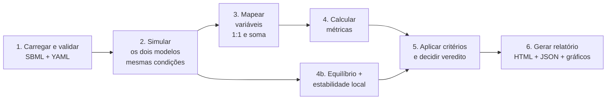

# Produto: biblioteca de verificação de modelos reduzidos (MVP)

> Cópia do documento de produto (26/09/2026). **As datas que valem são as dos milestones do GitHub**
> (prazo final: 29/11/2026). As datas da seção "Caminho até dezembro" abaixo são a proposta original.
> As tarefas estão nas issues do repositório; cada uma cita as capacidades (F1, E1, …) desta página.

## Visão

**O produto é uma biblioteca Python que recebe um modelo original e um modelo simplificado e diz se o simplificado é aceitável, com porcentagem de critérios atendidos e as razões.** Nome provisório: ReduCheck.

**Problema.** Quem simplifica um modelo de EDOs hoje valida "no olho" ou com um script feito só para aquele modelo. Cada trabalho usa métricas, limites e condições de simulação diferentes, então os resultados não são comparáveis nem reproduzíveis.

**Para quem.** Pesquisadores que modelam sistemas biológicos com EDOs e precisam de uma versão mais leve do modelo para acoplar a outros (por exemplo, o modelo biomecânico). O primeiro usuário é o próprio grupo de pesquisa.

**Em uma frase.** Um "pytest para modelos reduzidos": você declara os critérios antes, roda, e ele responde o que passou, o que falhou e por quê.

## Valor entregue

O valor central é transformar "acho que a simplificação está boa" numa decisão reproduzível e justificada.

| Para quem | O que ganha |
| --- | --- |
| Pesquisadora que simplifica um modelo | Um veredito com razões em minutos, sem escrever código de comparação. Roda de novo a cada ajuste. |
| Grupo de pesquisa | Um critério comum. Duas simplificações do mesmo modelo passam a ser comparáveis. |
| Quem lê o trabalho (banca, revisor) | Critérios declarados antes da comparação, num arquivo que pode ser auditado e reexecutado. |
| O TCC | Uma contribuição de software clara: padronização, configuração declarativa, métricas plugáveis e relatório. |

O que o produto **não** entrega: não cria simplificações e não valida o modelo contra dados experimentais. Ele verifica a fidelidade do simplificado ao original.

## Escopo do MVP

O MVP é **genérico na arquitetura e limitado no que promete**. Qualquer modelo de EDOs em SBML entra, mas só as análises listadas abaixo são garantidas.

**Entra no MVP**

- Entrada em SBML (modelo original e simplificado) mais um arquivo de configuração em YAML.
- Simulação dos dois modelos nas mesmas condições (tempo, pontos de saída, solver, tolerâncias).
- Mapeamento de variáveis 1:1 (mesmo nome ou renomeado) e por combinação linear (ex.: M = Mo + M1 + M2).
- Métricas quantitativas plugáveis, com limite por variável.
- Medida do ruído numérico de referência (original contra ele mesmo).
- Análise qualitativa: um ponto de equilíbrio e a estabilidade local em cada modelo.
- Veredito com porcentagem de critérios atendidos, critérios obrigatórios vs. desejáveis e razões.
- Relatório legível (HTML ou Markdown) com gráficos, mais um JSON para uso em código.
- Uso por código Python e por linha de comando.
- Estudo de caso: modelo da Verly em SBML, com as duas simplificações.

**Fica de fora (declarado como trabalho futuro)**

- CellML e outros formatos.
- Mapeamentos por expressão arbitrária (ex.: razões, funções não lineares).
- Busca de todos os equilíbrios e estabilidade global.
- Incerteza de parâmetros (amostragem, como em Frøysa et al. 2018).
- Interface gráfica.
- Geração automática de simplificações.

**Depois do MVP (v1.0, se houver tempo):** segundo modelo (Lemaire 2004 do BioModels) para provar que a biblioteca é genérica.

## Input

O usuário fornece **três arquivos** e não edita código nenhum.

| Arquivo | Formato | Conteúdo |
| --- | --- | --- |
| Modelo original | SBML (.xml) | Equações, parâmetros e condições iniciais do modelo completo |
| Modelo simplificado | SBML (.xml) | O mesmo, para a versão reduzida. Variáveis eliminadas por QSSA ficam como regra algébrica (*assignment rule*) |
| Configuração | YAML | Como simular, como mapear as variáveis, quais critérios aplicar e onde salvar o relatório |

O arquivo de configuração é o "template" que as pessoas copiam e ajustam. Exemplo (nomes de variáveis ilustrativos; no modelo da Verly os macrófagos são `Mo`, `M1`, `M2`):

```yaml
versao: 1

modelos:
  original: modelos/verly_original.xml
  simplificado: modelos/verly_simp1.xml

simulacao:
  t_inicio: 0
  t_fim: 720           # na unidade de tempo do modelo (dias, no modelo da Verly)
  pontos: 1000
  solver: cvode
  tol_relativa: 1e-8
  tol_absoluta: 1e-10
  nao_negativas: true  # padrão: toda variável simulada tem que ficar >= 0
  sobrescrever:        # condições iniciais e parâmetros vêm do SBML; aqui são trocados
    parametros:        # vale para os DOIS modelos
      gamma: 0.2
    condicoes_iniciais:
      E2: 0.019
    original:          # só para um dos modelos; vence o bloco comum
      condicoes_iniciais:
        M1: 0.0

variaveis:
  - nome: M                       # nome usado no relatório
    original: [Mo, M1, M2]         # soma de variáveis do original
    simplificado: M
    core: true
  - nome: D
    original: D                    # mesmo nome nos dois
    simplificado: D
    core: true
  - nome: C
    original: {C1: 1.0, C2: 0.5}   # soma ponderada
    simplificado: C
    core: false

criterios:
  - metrica: nrmse                 # RMSE normalizado
    limite: 0.05
    variaveis: core                # ou uma lista: [M, D]
    obrigatorio: true
  - metrica: mape
    limite: 0.05
    variaveis: [M]
    obrigatorio: false
    parametros:                    # opções da própria métrica (ver tabela abaixo)
      epsilon: 1e-6                # pontos com |original| < epsilon saem da conta
  - metrica: erro_estacionario
    limite: 0.01
    variaveis: core
    obrigatorio: true
    parametros:
      fracao_final: 0.1            # média dos últimos 10% do tempo simulado
  - metrica: estabilidade_local    # mesmo tipo de estabilidade nos dois
    obrigatorio: true

relatorio:
  formatos: [html, json]
  pasta: resultados/
  niveis: 3                        # 2 junta "com ressalvas" em APROVADO (ver issue #1)
```

**Métricas disponíveis** (acrescentadas em v0.2; todas dizem, junto do valor, o que o número
significa e o que precisou ser descartado):

| Métrica | O que mede | Unidade | Parâmetros |
| --- | --- | --- | --- |
| `nrmse` | RMSE dividido pela amplitude (`max − min`) do original | fração (0,05 = 5%) | — |
| `mape` | erro relativo médio | fração | `epsilon` |
| `erro_max_abs` | maior erro absoluto, e em que instante | unidade da variável | — |
| `erro_max_rel` | maior erro relativo, e em que instante | fração | `epsilon` |
| `erro_estacionario` | erro relativo no fim da simulação | fração | `fracao_final` |

`epsilon` protege as métricas que dividem pelo original: os pontos com `|original| < epsilon`
são excluídos e o relatório diz **quantos**. Sem ele o valor explode onde a variável passa perto
de zero, que é o caso das variáveis do modelo da Verly que começam em zero. Omitido, vale
`10⁻⁶ · max|original|`, relativo à escala da variável (ver `docs/questoes-em-aberto.md`, item 17).
`fracao_final` é a fração final do **intervalo de tempo** cuja média é comparada; `0` (o padrão)
compara os valores finais.

Uma métrica nova é uma função decorada com `@registrar("nome")`, que pode viver fora da
biblioteca: o YAML passa a aceitar o nome e os parâmetros dela sem que nada no núcleo mude
(capacidade Q5).

**Duas formas de usar:**

- Linha de comando: `reducheck verificar config.yaml`
- Python: `resultado = reducheck.verificar("config.yaml")`, depois `resultado.aprovado` e `resultado.porcentagem`

**Antes de simular, a biblioteca valida a entrada e para com uma mensagem clara quando:**

- um arquivo não existe ou o SBML é inválido;
- uma variável citada no mapeamento não existe no modelo;
- uma variável core não tem mapeamento;
- uma métrica ou limite é desconhecido ou inválido;
- uma chave do YAML não existe no esquema (com sugestão do nome parecido);
- o pedido é válido no formato mas a capacidade ainda não está implementada (a mensagem diz
  qual capacidade e qual issue).

Toda mensagem diz o caminho do campo (`variaveis[2].original`) e, para nomes inexistentes,
sugere o mais parecido. Uma variável que a simplificação eliminou é declarada com
`simplificado: null` e exige `core: false`, já que não há o que comparar (acrescentado na
issue #9; ver `docs/questoes-em-aberto.md`, itens 9 a 13).

**Durante a simulação, ela para quando a integração não é confiável** (acrescentado na issue #12):
o solver falha, a série tem NaN ou infinito, ou uma variável fica negativa além da precisão que o
solver garante para ela (`tol_absoluta + tol_relativa · max|x|`). A mensagem diz a variável e o
instante. Um modelo cujas variáveis podem ser negativas declara `simulacao.nao_negativas: false`.
Nenhum desses casos gera veredito: uma integração quebrada comparada com outra produz números que
parecem métricas.

Ela também **avisa, sem parar**, quando uma escolha é arriscada: por exemplo, MAPE numa variável que
chega perto de zero, ou um limite de critério menor que 10× o ruído numérico da variável.

## Output

A saída principal é um **veredito em três níveis**, sempre acompanhado da porcentagem e das razões.

| Veredito | Regra |
| --- | --- |
| APROVADO | Todos os critérios passaram |
| APROVADO COM RESSALVAS | Todos os obrigatórios passaram, mas algum desejável falhou |
| REPROVADO | Pelo menos um critério obrigatório falhou, qualquer que seja a porcentagem |

A porcentagem conta cada par (critério, variável) como um item. Com 2 critérios em 3 variáveis core, são 6 itens.

(Decisão pendente com a orientadora: manter três níveis ou só aprovado/reprovado. Ver issue #1.)
Enquanto a decisão não sai, o padrão é três níveis e `relatorio.niveis: 2` junta "com ressalvas" em
APROVADO, sem mudar nenhuma medida: o que a opção desliga é o nível, não o item que falhou
(acrescentado na issue #13). No `resultado.json`, o nível vai em `veredito` e as contagens separadas
em `obrigatorios` e `desejaveis`; `aprovado` é estrito, verdadeiro só no APROVADO — é o que
corresponde ao código de saída 0 da linha de comando.

**Arquivos gerados na pasta de resultados:**

| Arquivo | Para quê |
| --- | --- |
| relatorio.html (ou .md) | Leitura humana: veredito, tabela de critérios, gráficos, avisos |
| resultado.json | Uso em código e em testes automatizados |
| graficos/ | Trajetória original vs. simplificado por variável, e o erro ao longo do tempo |
| series.csv | As séries simuladas, para quem quiser refazer a análise |
| config_usada.yaml | Cópia da configuração e versões das bibliotecas, para reprodutibilidade |

`relatorio.formatos` escolhe o que é escrito: `html`, `md` e `json`, em qualquer combinação
(padrão: `[json]`). O HTML é **um arquivo só** — os gráficos vão embutidos em base64 —, e o
Markdown é o mesmo relatório com os gráficos ligados aos PNG de `graficos/`. Os PNG saem
sempre que um dos dois formatos legíveis é pedido, a 300 dpi, para irem direto ao texto.
A ordem das seções é: veredito → resumo numérico → tabela de critérios (falhas primeiro) →
razões → avisos → gráficos → dados da execução (modelos, condições de simulação, versões e
data). Cada gráfico é um painel por variável mapeada: original (linha contínua) e
simplificado (tracejada) em cima, erro absoluto ao longo do tempo embaixo
(acrescentado na issue #14).

**Exemplo do topo do relatório** (valores ilustrativos):

```markdown
# Verificação: verly_simp1 vs. verly_original

Veredito: APROVADO COM RESSALVAS
Critérios atendidos: 7 de 8 (87,5%)
Obrigatórios: 6 de 6 | Desejáveis: 1 de 2

| Critério          | Variável | Valor  | Limite | Tipo        | Resultado |
|-------------------|----------|--------|--------|-------------|-----------|
| nrmse             | M        | 0,021  | 0,05   | obrigatório | passou    |
| nrmse             | D        | 0,034  | 0,05   | obrigatório | passou    |
| mape              | M        | 0,081  | 0,05   | desejável   | falhou    |
| estabilidade_local| —        | estável / estável | igual | obrigatório | passou |

Razões:
- mape em M falhou: erro de 8,1%, concentrado entre t = 0 e t = 40
  (transiente inicial); no estado estacionário o erro é 0,4%.

Avisos:
- Ruído numérico de referência: 0,0003 (desprezível frente aos limites).
```

O ruído numérico também vai para o `resultado.json`, em `ruido_numerico`, com o valor por variável,
o fator de tolerância usado (100) e as variáveis em que não foi possível medir.

Cada razão diz **qual critério falhou, por quanto e onde** no tempo. Um veredito sem explicação não é aceito como saída.

## Como funciona

A verificação é um pipeline de seis etapas; cada etapa é um módulo independente, o que permite testar e trocar partes sem mexer no resto.



O ruído numérico de referência é calculado na etapa 2 (o original simulado duas vezes, a segunda com tolerâncias 100× mais frouxas) e aparece no relatório como aviso; ele é medido nas variáveis do relatório, e não nas colunas do modelo, para poder ser lido contra os limites dos critérios. O motor de simulação proposto é o libRoadRunner (via Tellurium), que já lê SBML e calcula estado estacionário e Jacobiana.

## Complexidade e riscos

**Complexidade geral: média.** Nenhuma peça isolada é difícil; o esforço está em integrar, validar a entrada e explicar bem os resultados. As duas partes mais caras são converter o modelo da Verly para SBML e a análise qualitativa.

| Componente | Complexidade | Por quê |
| --- | --- | --- |
| Converter o modelo da Verly para SBML | Alta (manual) | 11 EDOs digitadas à mão; qualquer erro invalida o estudo de caso. Mitigação: escrever em Antimony e comparar com o código atual |
| Análise qualitativa (equilíbrio e estabilidade local) | Média-alta | O equilíbrio encontrado depende da condição inicial; comparar estabilidade entre modelos de dimensões diferentes exige cuidado |
| Mapeamento de variáveis | Média | 1:1 e soma são simples; o cuidado está em validar nomes e dar boas mensagens de erro |
| Veredito e razões | Média | A regra é simples; gerar razões úteis (onde no tempo o erro se concentra) dá trabalho |
| Carregar e validar a configuração | Baixa-média | Esquema YAML com validação (ex.: pydantic) |
| Simulação | Baixa | O libRoadRunner faz o trabalho pesado |
| Métricas | Baixa | Fórmulas conhecidas; o cuidado está nos casos perto de zero |
| Relatório | Baixa-média | Template HTML e gráficos em matplotlib |

**Riscos**

- **Escopo crescer** (maior risco). Mitigação: a lista "fica de fora" aprovada pela orientadora; toda ideia nova vai para trabalhos futuros.
- **O SBML não reproduzir o modelo original.** Mitigação: comparar as trajetórias do SBML com as do código atual antes de qualquer outra coisa.
- **A simplificação 2 (Mo, M1 e M2 agregados em M) não caber no mapeamento linear.** Mitigação: verificar cedo; se não couber, é um caso real para justificar trabalho futuro.
- **O libRoadRunner não achar o equilíbrio em modelos rígidos.** Mitigação: plano B de integrar até estabilizar e refinar com o scipy.
- **Prazo.** Mitigação: versões incrementais, cada uma já entregável à orientadora.

## Entregas do MVP

São 36 capacidades em 11 módulos; cada uma é algo que o produto *faz*. As issues citam esses IDs.

| ID | Capacidade | Módulo | Versão |
| --- | --- | --- | --- |
| F1 | Projeto Python instalável (`pip install -e .`), com estrutura de pacotes e dependências fixadas | Fundação | v0.1 |
| F2 | Testes automatizados rodando a cada alteração (pytest + CI no GitHub) | Fundação | v0.1 |
| F3 | Modelos de brinquedo em SBML (2–3 EDOs, solução conhecida) para testar a biblioteca | Fundação | v0.1 |
| E1 | Ler o arquivo YAML de configuração | Entrada | v0.1 |
| E2 | Validar o esquema da configuração com mensagens de erro claras | Entrada | v0.2 |
| E3 | Carregar e validar os dois SBML | Entrada | v0.1 |
| E4 | Checar se toda variável citada existe no modelo correspondente | Entrada | v0.2 |
| S1 | Simular os dois modelos com o mesmo tempo, pontos, solver e tolerâncias | Simulação | v0.1 |
| S2 | Sobrescrever condições iniciais e parâmetros pela configuração | Simulação | v0.2 |
| S3 | Medir o ruído numérico de referência (original vs. ele mesmo) | Simulação | v0.2 |
| S4 | Detectar e reportar falha de simulação (divergência, valores negativos, NaN) | Simulação | v0.2 |
| M1 | Mapeamento 1:1, com mesmo nome ou renomeado | Mapeamento | v0.1 |
| M2 | Mapeamento por soma e soma ponderada | Mapeamento | v0.2 |
| M3 | Ler variáveis eliminadas por QSSA a partir de *assignment rules* | Mapeamento | v0.2 |
| M4 | Marcar variáveis como core e selecioná-las em bloco nos critérios | Mapeamento | v0.2 |
| Q1 | Métrica RMSE normalizado | Métricas | v0.1 |
| Q2 | Métrica MAPE, com proteção perto de zero | Métricas | v0.2 |
| Q3 | Métrica de erro máximo absoluto e relativo | Métricas | v0.2 |
| Q4 | Métrica de erro no estado estacionário (fim da simulação) | Métricas | v0.2 |
| Q5 | Registro de métricas: adicionar uma nova sem mexer no núcleo | Métricas | v0.2 |
| Q6 | Avisar quando uma métrica é inadequada para a variável | Métricas | v0.3 |
| L1 | Encontrar um ponto de equilíbrio de cada modelo | Qualitativo | v0.3 |
| L2 | Calcular a Jacobiana e os autovalores no equilíbrio | Qualitativo | v0.3 |
| L3 | Comparar equilíbrios (via mapeamento) e o tipo de estabilidade entre os modelos | Qualitativo | v0.3 |
| V1 | Avaliar cada critério contra seu limite | Veredito | v0.1 |
| V2 | Separar critérios obrigatórios e desejáveis e aplicar a regra de três níveis | Veredito | v0.2 |
| V3 | Gerar a razão de cada falha: por quanto e onde no tempo | Veredito | v0.3 |
| R1 | Resultado em JSON | Relatório | v0.1 |
| R2 | Relatório legível com veredito, tabela, razões e avisos | Relatório | v0.2 |
| R3 | Gráficos original vs. simplificado e erro ao longo do tempo | Relatório | v0.2 |
| R4 | Exportar séries em CSV e a cópia da configuração usada | Relatório | v0.3 |
| U1 | Uso por Python: `verificar("config.yaml")` | Uso | v0.1 |
| U2 | Uso por linha de comando | Uso | v0.2 |
| C1 | Modelo da Verly em SBML, conferido contra o código atual | Estudo de caso | v0.2 |
| C2 | Simplificações 1 e 2 em SBML, com configurações prontas | Estudo de caso | v0.3 |
| D1 | README com instalação, exemplo mínimo e referência da configuração | Documentação | v0.3 |

Fica para a v1.0 (pós-MVP): segundo modelo (Lemaire 2004, BioModels) como prova de generalidade.

## Caminho até o fim de novembro

As versões são incrementais e **cada uma já pode ser mostrada à orientadora**. Datas válidas: milestones do GitHub.

| Marco (milestone) | Prazo | O que entrega | Critério para fechar |
| --- | --- | --- | --- |
| Marco 0 — Fundação e escopo | 04/10 | Escopo aprovado, repositório pronto, conversão do modelo iniciada | Lista "entra / fica de fora" aprovada |
| Marco 1 — v0.1 ponta a ponta | 11/10 | Modelos de brinquedo, mapeamento 1:1, NRMSE, veredito passou/falhou, JSON; modelo da Verly em SBML conferido | Um modelo de brinquedo aprovado e outro reprovado, com testes automatizados |
| Marco 2 — v0.2 caso real | 25/10 | Mapeamento por soma, métricas, veredito em três níveis, relatório com gráficos, linha de comando, simplificações em SBML | Relatório gerado para as simplificações 1 e 2 |
| Marco 3 — v0.3 MVP completo | 08/11 | Análise qualitativa, razões detalhadas, reprodutibilidade, README; código congelado | Todos os critérios de pronto atendidos |
| Marco 4 — Texto final | 29/11 | Resultados, conclusão, revisão da orientadora, entrega | Texto entregue |

**Ordem de ataque:** converter o modelo da Verly para SBML cedo. É o item mais arriscado e bloqueia todo o estudo de caso.

## Critérios de pronto do MVP

O MVP está pronto quando uma pessoa do grupo, só com o README, consegue verificar uma simplificação sem pedir ajuda.

- [ ] Instala com um comando e roda o exemplo do README sem erro.
- [ ] O modelo da Verly em SBML reproduz as trajetórias do código atual dentro do ruído numérico.
- [ ] Os modelos de brinquedo têm veredito esperado conhecido e a biblioteca acerta todos.
- [ ] As simplificações 1 e 2 geram relatórios, com vereditos coerentes com a análise feita à mão no TCC I.
- [ ] Toda falha no relatório vem com razão: critério, valor, limite e onde no tempo.
- [ ] Configuração inválida gera mensagem que diz o que está errado e onde.
- [ ] Adicionar uma métrica nova não exige mudar o núcleo (demonstrado com um exemplo).
- [ ] Rodar duas vezes a mesma configuração dá o mesmo resultado.
- [ ] Testes automatizados passando no CI.

## Decisões pendentes para a orientadora

- [ ] Aprovar a lista "entra / fica de fora" do escopo.
- [ ] Confirmar que a estabilidade global sai do escopo (o texto do TCC I promete essa análise).
- [ ] Confirmar SBML como único formato de entrada.
- [ ] A biblioteca será usada pelo grupo depois do TCC, ou é uma prova de conceito?
- [ ] Definir o termo: "verificação de fidelidade" vs. "validação".
- [ ] Levantar um exemplo do relatório do JEV para alinhar o formato da saída.
- [ ] Escolher o nome da biblioteca (ReduCheck é provisório).
