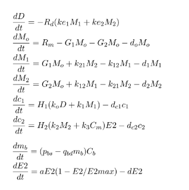

# Simplificação do modelo de Remodelação Óssea

**Autoras:** Ana Clara Verly, Isabella Mourão, Bárbara Quintela
**Data:** 22/04/2026
**Como chegou aqui:** documento passado pela Isabella em 28/09/2026 (issue #16). É a fonte
das simplificações do TCC I. Não existe código oficial delas; o que havia era uma
transcrição não oficial.

> Este arquivo é **material de referência** e não deve ser editado para "consertar" o
> modelo. Ele existe para provar de onde vieram as equações de `modelos/verly_simp1.ant`.
> As divergências entre este documento e `referencia/bone_estradiol.py` estão listadas no
> fim, e nenhuma delas foi resolvida por conta própria.

## Contexto

O modelo foi simplificado retirando as variáveis `Cm` (células-tronco mesenquimais) e `Mc`
(fibrocartilagem). Objetivo: reduzir o número de variáveis de estado e de parâmetros
livres, facilitando calibração, análise de sensibilidade, identificação paramétrica e
interpretação biológica do reparo ósseo sob influência hormonal.

### Parâmetros removidos junto com `Cm`

| Parâmetro | Significado |
| --- | --- |
| `apm` | efetividade de `c1` na inibição da proliferação de `Cm` |
| `amb1` | efetividade de `c1` na diferenciação de `Cm` |
| `apm1` | constante de estímulo de `c1` sobre a proliferação de `Cm` |
| `kpm` | taxa de proliferação de `Cm` |
| `dm` | taxa de diferenciação de `Cm` |
| `Klm` | capacidade de suporte de `Cm` |

### Parâmetros removidos junto com `Mc`

| Parâmetro | Significado |
| --- | --- |
| `pcs` | taxa de síntese de fibrocartilagem |
| `qcd1` | taxa de degradação de fibrocartilagem |
| `qcd2` | taxa de degradação de fibrocartilagem por osteoclastos |

### Termos removidos de outras equações

- **Equação de `c2`** (citocina anti-inflamatória): removido o termo `k3*Cm` (secreção de
  `c2` por células-tronco mesenquimais).
- **Equação de `Cb`**: removido o termo `F1*Cm` (`F1` depende de `dm` e `amb1`).

## Modelo simplificado (`D`, `M0`, `M1`, `M2`, `c1`, `c2`, `Cb`, `mb`, `E2`)

Imagem original do documento (as equações como estavam lá):



Transcrição em texto:

```python
dD/dt  = -Rd * (ke1*M1 + ke2*M2)
dM0/dt = Rm - G1*M0 - G2*M0 - d0*M0
dM1/dt = G1*M0 + k21*M2 - k12*M1 - d1*M1
dM2/dt = G2*M0 + k12*M1 - k21*M2 - d2*M2
dc1/dt = H1 * (k0*D + k1*M1) - dc1*c1
dc2/dt = H2 * (k2*M2) * E2 - dc2*c2
dCb/dt = Es + Ab*Cb*(1 - Cb)/klb - db*Cb
dmb/dt = (pbs - qbd*mb) * Cb
dE2/dt = a*E2*(1 - E2/E2max) - d*E2
```

Em LaTeX:

```latex
\frac{dD}{dt} = -R_d (k_{e1} M_1 + k_{e2} M_2)
\frac{dM_0}{dt} = R_m - G_1 M_0 - G_2 M_0 - d_0 M_0
\frac{dM_1}{dt} = G_1 M_0 + k_{21} M_2 - k_{12} M_1 - d_1 M_1
\frac{dM_2}{dt} = G_2 M_0 + k_{12} M_1 - k_{21} M_2 - d_2 M_2
\frac{dc_1}{dt} = H_1 (k_0 D + k_1 M_1) - d_{c1} c_1
\frac{dc_2}{dt} = H_2 (k_2 M_2) E_2 - d_{c2} c_2
\frac{dC_b}{dt} = E_s + A_b C_b (1 - C_b)/k_{lb} - d_b C_b
\frac{dm_b}{dt} = (p_{bs} - q_{bd} m_b) C_b
\frac{dE_2}{dt} = a E_2 (1 - E_2/E_{2max}) - d E_2
```

Observações que já vinham no documento:

- `H1` e `H2` são funções/fatores definidos no modelo original (manter a mesma definição do
  código anterior).
- Na imagem original, a equação de `c2` ainda aparece com `k3*Cm`; no texto ela já está sem
  esse termo, conforme a descrição da simplificação.
- A equação de `Cb` **não aparecia** na lista do modelo simplificado (confira na imagem:
  são oito equações, e `Cb` não é uma delas, com um espaço em branco onde ela entraria);
  foi incluída a partir da equação original, sem o termo `F1*Cm`. **Logo, o termo `Es` não
  vem deste documento — foi acrescentado na transcrição.** Ver a questão 34.
- Em `Ab*Cb*(1 - Cb)/klb`, conferir no código original se `klb` divide todo o termo ou só
  `(1 - Cb)` (ex.: logística `Ab*Cb*(1 - Cb/klb)`).

## Validação

Comparar as variáveis resultantes do modelo simplificado com as do modelo anterior, usando
a mesma configuração (parâmetros e condições iniciais):

- plotar os dois resultados no mesmo gráfico para comparação visual;
- calcular o erro entre eles e imprimir o valor no gráfico.

## Segunda simplificação — remoção de `M1` e `M2`

Modelo simplificado (variáveis: `D`, `M`, `c1`, `c2`, `Cb`, `mb`, `E2`) — **equações ainda
a definir**. É só isto que o documento traz sobre ela: um título e uma lista de variáveis.
A Isabella decidiu em 11/10/2026 **tirar a simplificação 2 do estudo de caso** (issue #16),
porque escrevê-la seria projetar uma simplificação nova, não transcrever a de alguém. Ver a
questão 36.

## Exemplo: cálculo da Jacobiana com SymPy

```python
import sympy as sp

# Define variables and functions
x, y = sp.symbols('x y')
f1 = x**2 + y
f2 = 5*x + sp.sin(y)

# Create a Matrix and calculate the Jacobian
funcs = sp.Matrix([f1, f2])
args = sp.Matrix([x, y])
jacobian_matrix = funcs.jacobian(args)
print(jacobian_matrix)
```

---

## Divergências entre este documento e `referencia/bone_estradiol.py`

Levantadas em 28/09/2026 ao escrever `modelos/verly_simp1.ant` (issue #16). **Nenhuma foi
resolvida por conta própria.** O detalhamento e o impacto numérico estão na seção
"Encontrado durante o desenvolvimento" de `docs/questoes-em-aberto.md` (questões 34 a 37).

| # | Ponto | Documento | `bone_estradiol.py` | Situação |
| --- | --- | --- | --- | --- |
| 1 | Fonte de `Cb` | `Es + ...` | `F1*Cm + ...` | `Es` **não existe no código original e não tem valor**. É o único termo de `Cb` que não é proporcional a `Cb`: sem substituto, `Cb ≡ 0` e `Mb ≡ 0`. Lido como o estradiol `E2` (Isabella, 29/09/2026), **ainda sem confirmação da Ana Clara**; as unidades não fecham. Ver a questão 34. |
| 2 | Degradação de `c1` | `- dc1*c1` | `- (d_c1*C1)*E2` | O documento não tem o `E2`. **Decidido em 29/09: seguir o documento.** Muda o NRMSE de `C1` de 3,03 para 0,68, então parte da diferença medida em `C1` não é efeito da simplificação. Mesmo ponto da questão 3 de `referencia/duvidas.md`. |
| 3 | Logística de `Cb` | `Ab*Cb*(1 - Cb)/klb` | `Ab*Cb*(1 - Cb/k_lb)` | O próprio documento manda conferir no código. Foi adotada a forma do código. |
| 4 | `dE2/dt` | `a*E2*(1 - E2/E2max) - d*E2` | `((E2max - E2)/E2max)*ae2*E2 - de2*E2` | **Equivalentes**: `(E2max - E2)/E2max == 1 - E2/E2max`. Não é divergência. |
